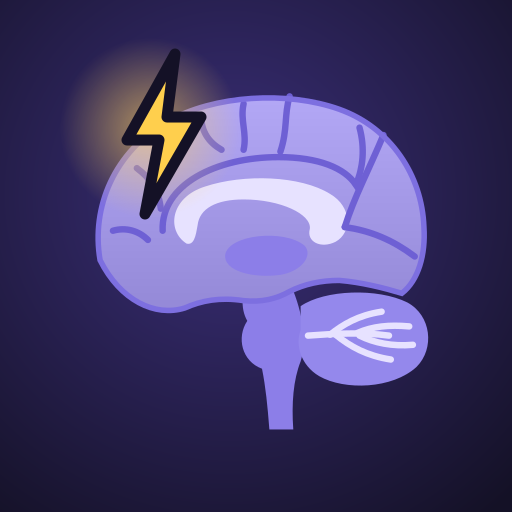
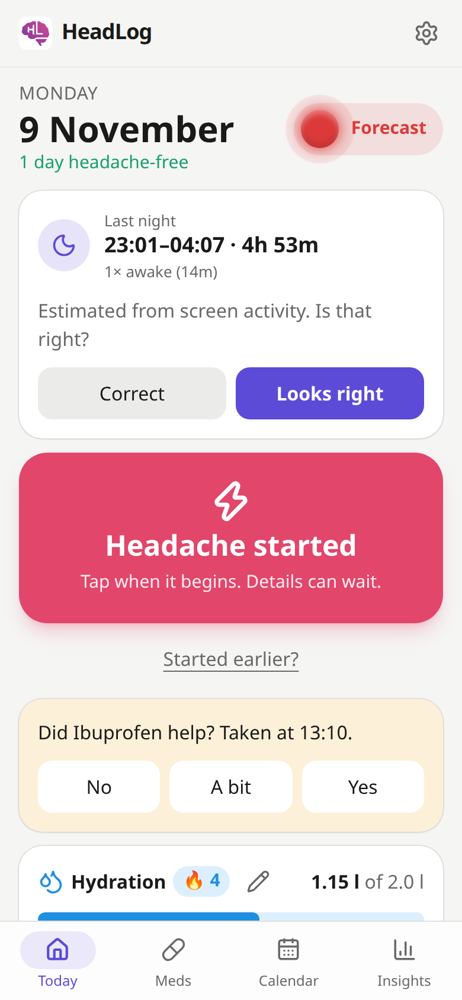
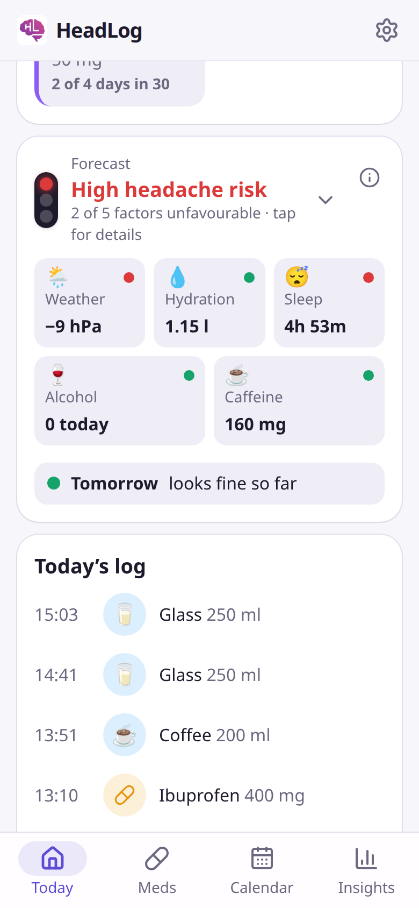
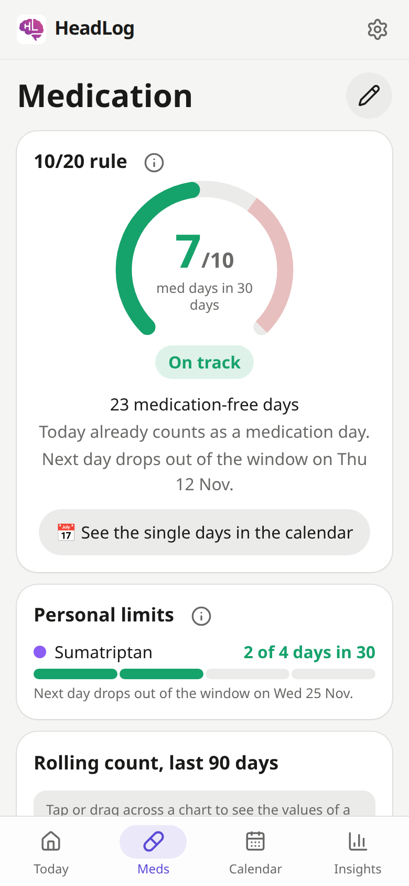
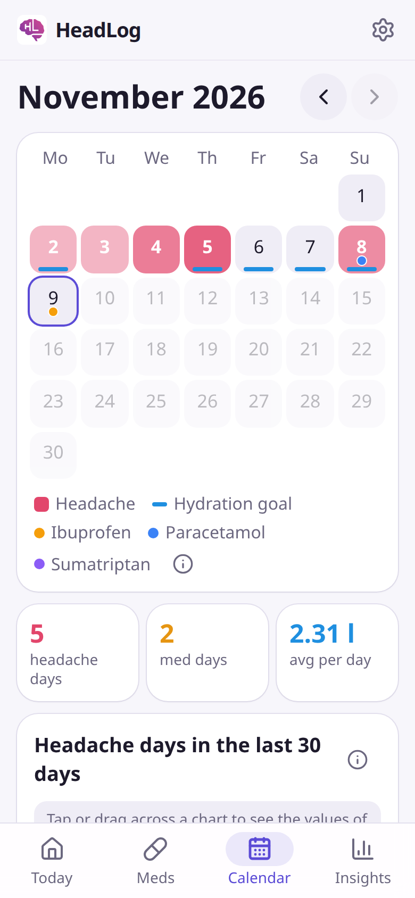
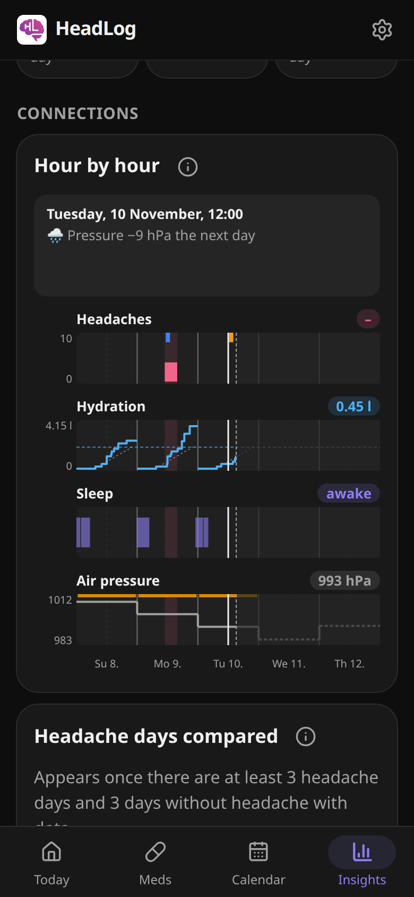

<p align="center"></p>

<h1 align="center">HeadLog</h1>

<p align="center">
  <em>A one-tap headache, medication and water diary for Android. Tap when a headache starts, tap what you took, tap what you drank. HeadLog keeps an eye on the 10/20 rule and shows you patterns. English and German. No account, no server: all data stays on your phone.</em>
</p>

<p align="center">
  
  
  
  
  
</p>

<p align="center"><a href="https://github.com/tillraab/headlog/releases/latest">Download the latest APK</a> · <a href="docs/videos/HeadLog-teaser.en.mp4">Teaser video (47 s)</a> · <a href="docs/videos/HeadLog-guide.en.mp4">Guide video (4:35)</a></p>

## Features

- **One tap when it starts.** A big button starts a headache with the current time; the time can be changed in the entry. A live timer runs until you tap "Headache is gone". Intensity (1 to 10), symptoms and triggers (nausea, aura, stress, poor sleep, ...) and a note are optional and can be added any time.
- **Your medication as buttons.** Define your own list with name, dose, type (pain reliever, triptan, combination, opioid, preventive, other) and color. One tap logs an intake. Afterwards you can rate whether it helped.
- **Hydration.** Your own drink buttons (glass 250 ml, bottle 700 ml, coffee, tea, ...) and a daily goal with a progress bar, right at the top of Today.
- **Calendar.** Headache days shaded by intensity and dots for medication days. Chips choose what is marked: headaches, medication and each of the five forecast factors, whose symbol marks the days it was unfavourable (for hydration, days you missed your goal). Tap a day to see, edit or add entries after the fact, and open its weather, sleep, hydration, caffeine and alcohol.
- **10/20 rule.** Take acute headache medication on fewer than 10 out of any 30 days, as the German migraine guideline (DGN/DMKG) advises. HeadLog shows your current count, what taking something today would mean, when the next medication day drops out of the window, and the overuse limits per medication type (ICHD-3) over the last 30 days, each as a wheel. Preventive medication doesn't count.
- **Forecast traffic light** on Today with five factors as tiles: weather (a pressure drop of more than 5 hPa from today to tomorrow), hydration (yesterday, and today against your pace), last night's sleep (under 5 hours, or asleep under 85 % of the night), alcohol and a drop in caffeine. Green with no unfavourable factor, yellow with one, red with two or more. Tap a tile for its chart, the key numbers and a tip; its (i) gives the rule, what studies show and the full references.
- **Tomorrow's risk** as a row under the tiles, and an optional evening notification when tomorrow does not look green. It counts only what matters for tomorrow: a pressure drop from tomorrow to the day after, too little to drink today and alcohol today. Settings shows what tonight's warning will say.
- **Weather and sleep:** daily weather at your home town (Open-Meteo, only the town's coordinates are sent) and a sleep estimate from screen activity, with wake breaks. Each morning Today shows last night with Looks right / Correct until it is confirmed, and an optional notification asks the same. The sleep editor is a timeline: drag falling asleep and waking up, or pick where the night began (after a longer wake break) and ended (at a wake break in the second half of the night), tap a wake break to edit it magnified, and see when the screen was on.
- **Insights** over 3, 7 or 30 days or a range you choose, with headache and medication days per 30 days: a timeline of headaches, headache and medication days in the 30 days up to each day, hydration, sleep and air pressure, hour by hour for 3 and 7 days, running on into the pressure forecast. Tap or drag across it to see the values at that moment and what happened around it. Orange marks the days before a pressure drop. Also a comparison of headache days with other days, headache and medication days per month, average duration and intensity, weekdays and times of day headaches start, how well each medication helped, and your most common triggers.
- **Doctor report (PDF)** on one page for 1 to 12 months, from Insights or Settings: key figures, a headache calendar, charts of headache and medication days per month and of the 10/20 rule over time, medication with how often it helped and your limits, and the most common triggers. CSV with every entry for the same period.
- **Personal limits per medication**, e.g. at most 5 triptan days in any 30 days, shown on the button, in the Meds tab and in the report.
- **Reminders:** after taking medication, a question whether it helped (default after one hour; answer right in the notification), during a headache a question every few hours whether it is still there, reminders at noon and in the evening if you are behind your hydration goal, and, if you like, a reminder to drink when you have not logged a drink for a while (default: 2 hours, between 8:00 and 20:00).
- **Undo instead of "are you sure?"** Every quick action shows an undo button.
- **Backup** as a JSON file and **CSV export** for your doctor, both through the Android share sheet.
- **Optional cloud backup** to a secret gist in your GitHub account, updated whenever you leave the app. Every backup is kept as a version, so you can go back to any earlier state by date and time.
- Swipeable tabs, light and dark theme, haptic feedback, Android back button support.

## Install on your phone

HeadLog is not in the Play Store. You install the APK from the GitHub releases, either directly or through Obtainium, which also keeps it updated.

### Option A: Obtainium (recommended, gets updates automatically)

[Obtainium](https://obtainium.imranr.dev/) watches GitHub releases and installs new versions.

1. On your phone, open <https://github.com/ImranR98/Obtainium/releases/latest>, download the APK that ends in `arm64-v8a.apk` (or the universal one) and install it. Android asks once to allow installing apps from your browser: allow it.
2. Open Obtainium, tap **Add App**, enter `https://github.com/tillraab/headlog` and tap **Add**.
3. Tap **Install**. Android asks once to allow Obtainium to install apps: allow it.

Obtainium checks for updates in the background and notifies you when a new release is out.

### Option B: download the APK directly

1. On your phone, open <https://github.com/tillraab/headlog/releases/latest>.
2. Under **Assets**, tap `headlog-<version>.apk`.
3. Open the downloaded file and allow your browser to install apps when asked.

Updates work the same way: install the newer APK over the old one. Your data stays.

### First steps

1. Open **Settings** (gear icon, top right). Edit **My medication** to match what you take, and **My drinks** to match your glasses and bottles. Set your daily water goal.
2. Try **Load demo data** (Settings → Advanced) to see every screen with 90 days of data, including a risk warning. **Delete all data** clears it again.
3. The data lives only on your phone, so uninstalling the app deletes it. Either export a JSON backup now and then (Settings → Data), or turn on the Gist backup:
   1. On GitHub, open <https://github.com/settings/personal-access-tokens/new>, give the token a name and a long expiration, and under **Account permissions** set **Gists** to **Read and write**. Generate it and copy it.
   2. In HeadLog, Settings → Cloud backup, paste the token and tap **Connect**.
   3. The backup lives in a secret gist named "HeadLog backup", visible under your GitHub profile → Gists.

## Development

Requires [Bun](https://bun.sh). For the APK also JDK 21 and the Android SDK.

```bash
bun install
bun run dev      # dev server in the browser
bun run check    # type check
bun run test     # unit tests
```

Project layout, data model, notification and release rules for contributors (human or AI agent) are in [CLAUDE.md](CLAUDE.md). The app icon is drawn in [assets/icon.svg](assets/icon.svg); `bun run icons` renders the favicon and all Android icon sizes from it.

Build the APK locally:

```bash
bun run build
bunx cap sync android
cd android && ./gradlew assembleRelease
```

### Releasing

Releases are published by the maintainer. The steps are in [CLAUDE.md](CLAUDE.md#releases).

## Tech stack

SvelteKit 2 and Svelte 5 (static adapter), Tailwind CSS 4, Dexie (IndexedDB), date-fns, Lucide icons, and Capacitor 8 for the Android app.

## Disclaimer

HeadLog is a diary, not a medical device. The 10/20 rule and the overuse thresholds are guidance. Talk to your doctor about your headaches and medication.

## License

[MIT](LICENSE)
